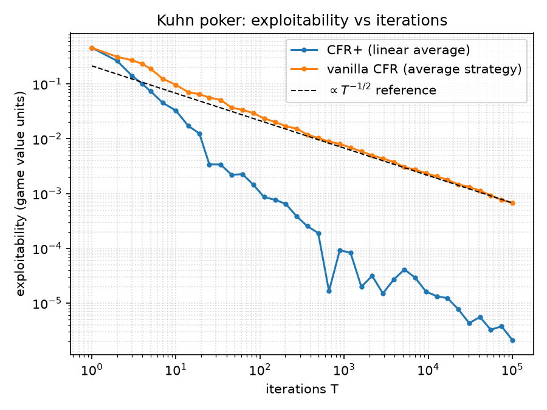
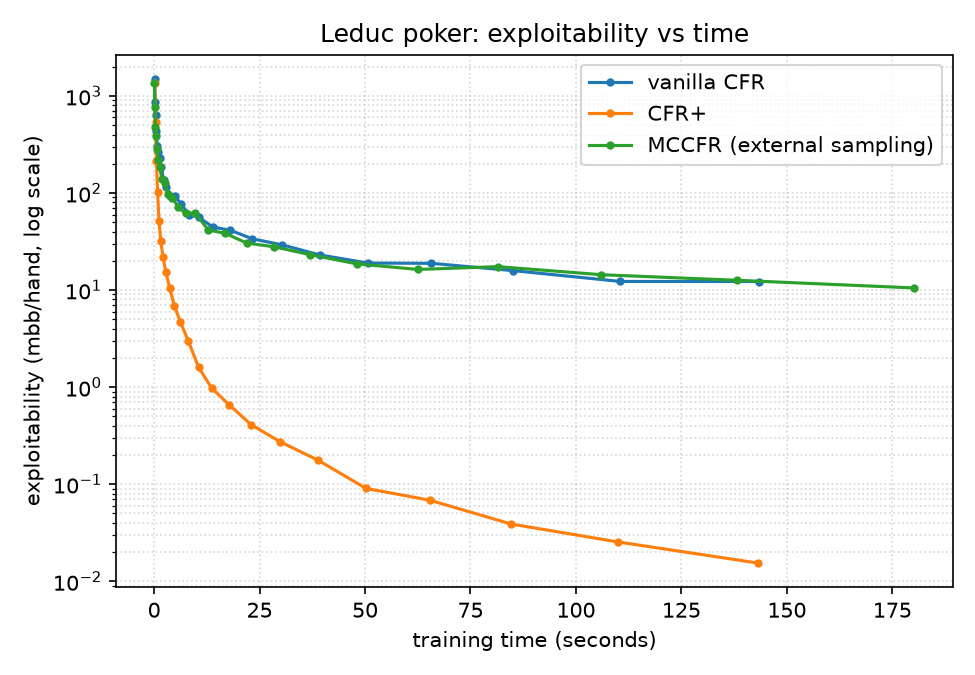
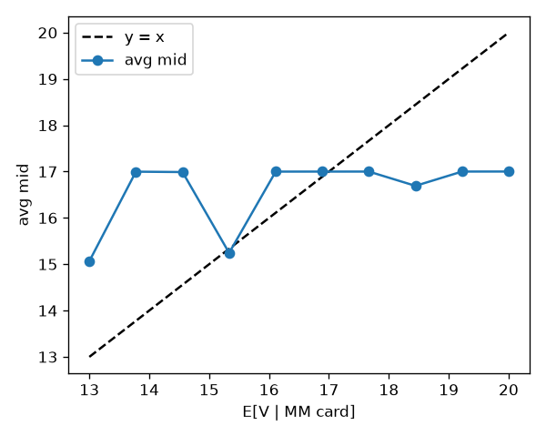
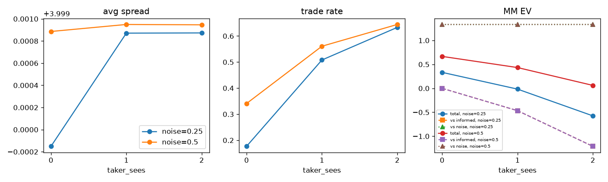
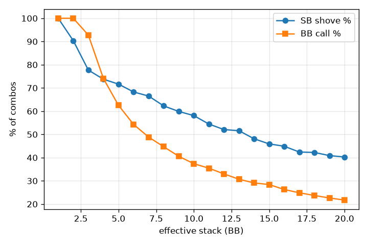
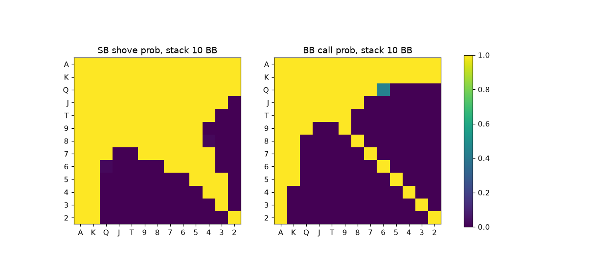

# Poker Solver

## Overview
Counterfactual Regret Minimization (CFR) solvers for small poker games, built from scratch in Python.
The project computes approximate Nash equilibria for Kuhn and Leduc poker, measures how close they are
to equilibrium (exploitability), and uses them to build bots, an exploiting agent, and an adaptive agent
that shifts from equilibrium play toward exploiting a weak opponent.

All results are verified against known values (e.g. Kuhn poker game value = -1/18 for player 1).

**Status:** Phases 1–8 done (solvers, evaluation, bots, adaptive agent, terminal play, writeup: [analysis/writeup.md](analysis/writeup.md)). See [PROGRESS.md](PROGRESS.md).

## Quickstart
Requires Python 3.11.

```bash
pip install -r requirements.txt
pytest -q                          # full test suite (83 tests, about 50 s)
python scripts/run_kuhn_cfr.py     # vanilla CFR on Kuhn, 100k iters -> analysis/kuhn_cfr.csv
python -m play.cli --game kuhn --seed 1 --hands 5   # play the bot in the terminal
```

Every result in the table below has its reproduce command next to it. Full command list and per-result notes: [analysis/results.md](analysis/results.md). Math notes and Q&As per phase: [LEARNING.md](LEARNING.md).

## Kuhn + CFR
Kuhn poker: 3 cards, ante 1, one bet of 1. Vanilla CFR keeps cumulative regret per information set, plays by regret matching, and the reach-weighted *average* strategy converges to Nash. The result lies in the known equilibrium family (P1 bets J with $\alpha\in[0,1/3]$, K with $3\alpha$; our run gives $\alpha\approx0.21$, the `p_bet` of infoset `0` in [analysis/kuhn_cfr.csv](analysis/kuhn_cfr.csv)). Math in [LEARNING.md](LEARNING.md).

## Games
| Game  | Deck | Rounds | Notes |
|-------|------|--------|-------|
| Kuhn  | 3 cards (J, Q, K) | 1 | Known closed-form equilibrium family; game value -1/18 |
| Leduc | 6 cards (2 suits × J, Q, K) | 2 (one private card, one public card) | Standard CFR benchmark |

## Solvers
| Solver | Description |
|--------|-------------|
| Vanilla CFR | Full-tree traversal; regret matching; average strategy converges to Nash at $O(1/\sqrt{T})$ |
| CFR+ | Regrets floored at zero, linearly weighted averaging; typically much faster in practice |
| MCCFR (external sampling) | Samples chance and opponent actions; cheaper iterations for larger games |

Evaluation: exact best response and exploitability (reported in mbb/hand for Leduc).

## Play against the bot

```bash
python -m play.cli --game kuhn --seed 1 --hands 5
python -m play.cli --game leduc --seed 1 --hands 5
```

You face the CFR+ equilibrium bot (average strategy from `analysis/strategies/`). Seats alternate each hand. Kuhn moves: `p` pass/check/fold, `b` bet/call. Leduc moves: `c` check/call, `r` raise. After each bot move the CLI prints the bot's action probabilities at that infoset, plus a running chip total.

## Results
Each row lists the command that reproduces it; the source csv is in `analysis/`. Details in [analysis/results.md](analysis/results.md).

<!-- RESULTS_TABLE_START -->
| Metric | Value | Command |
|--------|-------|---------|
| Kuhn game value (vanilla CFR, 100k iters) | -0.055555 (target -1/18 = -0.055556) | `python scripts/run_kuhn_cfr.py` |
| Kuhn exploitability after 100000 iters (vanilla CFR) | 6.76e-04 (log-log slope -0.544, T>=10k) | `python scripts/kuhn_convergence.py --solver cfr && python analysis/plot_convergence.py` |
| Kuhn exploitability after 100000 iters (CFR+) | 2.14e-06 (log-log slope -0.849, T>=10k) | `python scripts/kuhn_convergence.py --solver cfr_plus && python analysis/plot_convergence.py` |
| CFR+ speedup vs vanilla (iters to expl < 0.001) | 331x (43080 vs 130 iters) | `python scripts/kuhn_convergence.py --solver cfr && python scripts/kuhn_convergence.py --solver cfr_plus` |
| Leduc exploitability (mbb/hand), last checkpoint within 140 s: CFR / CFR+ / MCCFR | 12.26 / 0.0254 / 12.61 | `python scripts/leduc_benchmark.py && python analysis/plot_leduc.py` |
| Exploiter (exact BR) vs bots, mbb/hand ±95% CI, 300k hands each | call +1470±7, raise +2377±14, tight +697±11, random +2367±18 (equilibrium: +636±7, +327±19, +61±11, +716±13) | `python scripts/bot_matches.py --pairs 150000 --seed 0` |
| Adaptive agent vs bots, mbb/hand ±95% CI, 40k hands each (cap 1.0 / cap 0.2) | call +1315±19 / +810±20, raise +2194±40 / +632±51, tight +638±36 / +152±32, random +1715±40 / +881±36; vs equilibrium -1±27 / +7±24 | `python scripts/adaptive_matches.py --pairs 20000 --seed 0` |
<!-- RESULTS_TABLE_END -->

## Charts


Kuhn exploitability vs iterations (log-log), vanilla CFR and CFR+.



Leduc exploitability (mbb/hand) vs wall-clock time (log scale): vanilla CFR, CFR+, external-sampling MCCFR.

## Market-making game
Zero-sum card game: MM quotes (mid, spread) knowing one card; taker (informed or, w.p. 0.25, noise) buys/sells/passes; value = sum of 3 cards. Solved with CFR+ (exploitability 3.85e-05 at 2000 iters). Noise traders are needed: against an informed-only zero-sum taker the MM's EV is at most 0, so it would quote as wide as possible. Observed: MM always quotes the widest spread (4), so spread did not widen with taker information; MM loses more to informed flow as `taker_sees` rises (EV vs informed 0 / -0.466 / -1.211) and earns +1.333 vs noise. Mids only weakly track E[V | card] on this coarse grid (max deviation 3.22). Numbers and commands: [analysis/results.md](analysis/results.md); notes in [LEARNING.md](LEARNING.md).





## Push/fold (heads-up no-limit)
SB shoves or folds, BB calls or folds; blinds 0.5/1, stacks 1-20 BB. 169x169 preflop equity table (Monte Carlo boards, card-removal weighted), vectorized CFR+ per stack. Observed: exploitability <= 9.71e-07 BB/hand at every stack; combo-weighted shove% 100.0 (1 BB), 58.1 (10 BB), 40.3 (20 BB), decreasing with stack. These are equilibria of this model with Monte Carlo equities; external comparison pending. Numbers and commands: [analysis/results.md](analysis/results.md).

Query: `python -m play.pushfold --stack 10 --hand AJo`





## Roadmap
- [x] Phases 1–8: Kuhn/Leduc CFR, CFR+, MCCFR, exploitability, bots, adaptive agent, terminal play, writeup
- [x] Phase 9: market-making card game (MM quotes bid/ask, informed + noise taker) solved with CFR+ — quotes vs private card, spread vs taker information, adverse selection
- [ ] Phase 10 (docs done, verification pending): heads-up no-limit push/fold solver (169x169 equity table, equilibrium for 1–20 BB stacks, range charts, query tool)

## What I learned
Detailed notes per phase in [LEARNING.md](LEARNING.md). Raw results and reproduce commands in [analysis/results.md](analysis/results.md).
